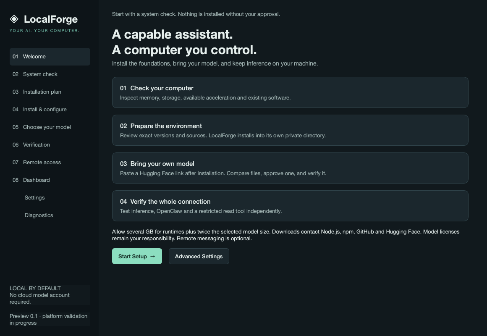

# LocalForge

A Python/PySide6 desktop installer for a private OpenClaw environment and local GGUF inference. The source, native GUI, installation backends, download manager, tests, and packaging scripts are implemented here.

**Release status: engineering preview, not a production-certified universal installer.** macOS ARM64 is the locally exercised platform. Windows, Intel macOS and Linux have implementation/build targets but require native validation. The full acceptance checklist in the request is not yet satisfied. See [validation and limitations](docs/VALIDATION.md).



## Download and install on macOS

[Download LocalForge 0.1.0 for Apple Silicon Macs (.dmg)](https://github.com/Yaascine/localforge/releases/download/v0.1.0/LocalForge-0.1.0-macos-arm64.dmg)

This engineering preview is for Apple Silicon Macs (M-series chips). It includes Python and Qt; you do not need to install Python separately. Windows, Linux and Intel Mac installers are not included in this release.

1. Download the DMG, open it, and drag LocalForge into Applications.
2. Launch LocalForge. The preview is ad-hoc signed, not Developer ID signed or notarized. macOS may require approval in System Settings → Privacy & Security.
3. Follow the wizard to check hardware, review and approve runtime installation, select a supported Hugging Face GGUF model, and run verification.

Internet access is required to download runtimes and model weights; these are not bundled in the DMG. Closing LocalForge stops its managed services.

[Release notes, source archive and SHA-256 checksums](https://github.com/Yaascine/localforge/releases/tag/v0.1.0)

## Run from source

Install Git and uv, then:

```sh
git clone https://github.com/Yaascine/localforge.git
cd localforge
uv sync --frozen --extra dev
uv run localforge
```

Python 3.12+ is required for source execution. Packaged applications include Python and Qt; target AI runtimes are downloaded only after a reviewed plan is approved.

On macOS, open the DMG in `dist/`, drag LocalForge to Applications and launch it. The development build is ad-hoc signed, **not Developer ID signed or notarized**. Do not treat it as an OS-trusted distribution. Signing instructions are in [packaging](docs/PACKAGING.md).

## What works in the application

- A ten-page native setup wizard, light/dark themes, asynchronous installation work, diagnostics and a process dashboard.
- Hardware/OS/RAM/disk probes, GPU/driver discovery, network probes, package-manager and existing-installation detection, and port-conflict checks.
- Reviewable, version-pinned installation plans. Node is downloaded from nodejs.org with SHA-256 verification; OpenClaw is installed into a private npm prefix; Ollama and llama.cpp use digest-verified official release archives.
- A separate OpenClaw state/config/workspace, with schema validation and backup/rollback on invalid configuration. Existing personal OpenClaw configuration is not overwritten.
- Hugging Face model repository/direct file URLs, immutable revisions, file browsing, quantization discovery, license metadata and authenticated access through the OS credential store.
- Explicit memory estimates that account for context, KV cache dimensions when supplied, runtime overhead and disk duplication. Missing metadata produces an Unknown result; runtime load tests remain authoritative.
- Streaming downloads, pause/resume, retry, space checks, SHA-256 verification and reuse of verified files. Cross-host redirects do not receive Hugging Face credentials.
- Ollama GGUF registration and native API inference; llama.cpp GGUF loading and OpenAI-compatible API inference. Both run on loopback on dedicated ports.
- Independent inference, OpenClaw and read-tool checks, including recorded evidence from the supported trajectory exporter. An unverified tool action leaves a Limited result and disables tools for that model.
- Telegram/Discord credential validation and strict numeric user allowlists, stored credentials in the OS keychain and outbound-only messaging connections. Live provider behavior still requires account-based validation.
- Start/stop/restart, model switching and previous-model recovery, diagnostic exports, and app-owned runtime removal that preserves models, workspace, configuration and unrelated software.

## Supported model path

Select a **single-file GGUF with published LFS SHA-256 metadata**. The app deliberately does not execute model repository code. Split GGUF, automatic Safetensors/PyTorch conversion, multimodal projector setup and arbitrary remote-code architectures are not supported in this release. They appear as unsupported entries rather than being silently ignored.

Ollama is the default engine. llama.cpp is an explicit alternative with a conservative CPU configuration. The selected engine and model architecture still need a successful runtime load; a `.gguf` extension is not a compatibility guarantee. A minimum 16K context is exposed for OpenClaw; large context windows can consume substantial memory. After download, bounded GGUF metadata parsing caps context to the model native limit. Models below 16K can run inference but are reported as unsuitable for OpenClaw setup.

## Privacy and security boundaries

The installer is not a security sandbox. It runs trusted runtime packages as the current user. npm lifecycle scripts are publisher code, disclosed in the approval screen. No administrator escalation or unverified remote shell script is used. Runtime downloads need network access to Node.js, npm, GitHub and Hugging Face.

OpenClaw gets a dedicated workspace and an explicit tool allowlist containing `read` and `session_status`; shell, editing, browser and network-fetch tools are denied. Workspace-only filesystem access is configured. This reduces the effects of untrusted prompts; it is not a claim to solve prompt injection. Powerful computer-command/task execution and a sensitive-operation approval bridge are not enabled in this release.

Credentials go to the operating-system keychain (macOS Keychain, Windows credential storage, Linux Secret Service). There is no plaintext fallback. Gateway authentication uses a per-launch secret injected through the child environment. Local model APIs are loopback-only. llama.cpp uses an ephemeral API key; Ollama has no local API authentication, so **other processes running locally can access Ollama**. No public-network binding is exposed.

The application manages only its own child processes. Closing it stops its services. Persistent login services are not installed. Private state lives under the platform's `LocalForge` user-data directory, displayed in Settings.

## Development and packaging

```sh
uv run pytest -q
uv run ruff check src tests packaging --select F
uv run python packaging/build.py
```

The build script produces a native macOS `.dmg`, Windows Inno Setup `.exe`, or Debian/Ubuntu `.deb` on the corresponding host. CI defines native build/test jobs; a workflow definition is not evidence those jobs have run. See [architecture](docs/ARCHITECTURE.md), [research](docs/RESEARCH.md), [packaging](docs/PACKAGING.md), and [validation](docs/VALIDATION.md).

Runtime versions are resolved at plan creation, displayed for approval and recorded in state. The desktop dependency graph is locked in `uv.lock`. Runtime dependencies and platform SDKs are not bit-for-bit reproducible; release artifacts need independent signing and native certification.
